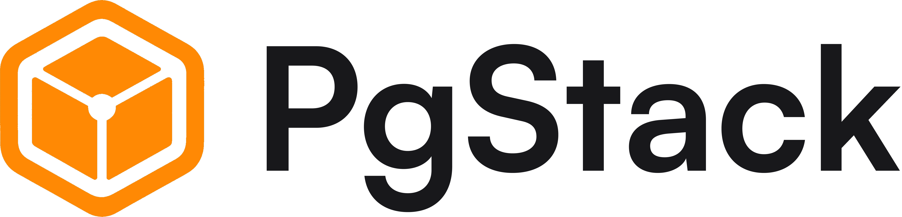

# 

The open-source CLI for [PgStack](https://pgstack.io/). PgStack Access provides temporary, recorded access to PostgreSQL. Start a session from your terminal, then connect with `psql` or your favorite database client.

## Install

On macOS or Linux:

```sh
curl -fsSL https://pgstack.io/install.sh | bash
```

The installer downloads a standalone executable from this repository's [GitHub Releases](https://github.com/pgstack-io/pgstack/releases), verifies its SHA-256 checksum, and installs it to `~/.local/bin/pgstack`. No Node.js or Bun installation is required. Add `~/.local/bin` to your `PATH` if needed. Re-run the installer to upgrade.

Windows users can download `pgstack-windows-x64.exe` from the release assets. Linux releases include glibc and musl builds for x64 and arm64; macOS supports Intel and Apple Silicon.

To choose another installation directory:

```sh
curl -fsSL https://pgstack.io/install.sh | PGSTACK_INSTALL_DIR="$HOME/bin" bash
```

## Connect to Postgres

Sign in through your browser, confirm the code from your terminal, and connect the CLI:

```sh
pgstack auth login
pgstack access start --env production --reason "Investigate delayed orders"
```

PgStack prints a temporary PostgreSQL connection URL. Use it with `psql`, a GUI, or another PostgreSQL client. You need a PgStack account and a project with Access configured; this CLI connects to the hosted PgStack API. Team admins and engineers can create, extend, and revoke their own sessions. Regular members can sign in and list their own active sessions.

Use a project slug directly, or select an environment. Replace angle-bracketed placeholders with your own slugs:

```sh
pgstack access start <project-slug> --duration 30m
pgstack access start --env staging
```

When several projects share an environment, the CLI shows `slug - project name` and asks which to use. Noninteractive commands require an unambiguous selection. Environment names are `testing`, `development`, `staging`, and `production`.

## Read-only sessions

```sh
pgstack access start --env production --read-only --reason "Investigate delayed orders"
```

`--read-only` guards against accidental writes on every connection using the session URL. The proxy starts upstream transactions in read-only mode and sets 60-second statement and idle-in-transaction timeouts.

| SQL | Proxy behavior |
| --- | --- |
| `SELECT`, including joins and read-only CTEs, `VALUES`, `TABLE`, `SHOW` | Allowed |
| Plain `EXPLAIN` of an allowed read, basic transaction and savepoint commands | Allowed |
| `INSERT`, `UPDATE`, `DELETE`, `MERGE`, `CREATE`, `ALTER`, `DROP`, `TRUNCATE` | Blocked, including writes inside CTEs |
| `SELECT INTO`, `SELECT ... FOR UPDATE` or `FOR SHARE`, `EXPLAIN ANALYZE` | Blocked |
| `SET`, `RESET`, `SET ROLE`, `BEGIN READ WRITE`, `COPY`, `CALL`, `DO`, SQL `PREPARE` and `EXECUTE` | Blocked. Parameterized queries through the PostgreSQL wire protocol are supported. |
| Multiple statements in one simple query | Allowed only if every statement passes |
| Function calls inside allowed queries | Allowed unless the proxy blocks the function by name, such as `set_config`, `nextval`, or `dblink_exec` |

For a stronger guarantee against database writes, connect to a read-only PostgreSQL replica or use a restricted PostgreSQL role.

## Manage sessions

```sh
pgstack auth status
pgstack access list
pgstack access list <project-slug>
pgstack access extend <session-slug> --duration 15m
pgstack access revoke <session-slug> --reason "Investigation complete"
pgstack auth logout
```

Sessions last up to one hour. Extensions add time but cannot leave more than one hour remaining. Expired or revoked sessions cannot be extended. After revocation, open connections close within one minute.

Use `--organization <slug-or-id>` when you belong to multiple organizations, `--role <name>` to select a configured database role, and `--json` for scripts. `--reason` is required when your project requires a reason. See `pgstack --help` and `pgstack access --help` for all commands.

Login opens your browser; `pgstack auth login --no-browser` prints the URL instead. Credentials are stored in `~/.config/pgstack/credentials.json`. `PGSTACK_CONFIG_DIR` changes that location. Authentication renews during active CLI use and expires after 30 days of inactivity. Logout removes this computer's saved token; it does not invalidate copies or revoke Access sessions. Compiled releases always connect to `https://api.pgstack.io`.

## Development

The CLI is written in TypeScript and compiled with Bun. With [Devbox](https://www.jetify.com/devbox) installed:

```sh
make install
cp .env.example .env
make check
make test
make up auth
make build
./dist/pgstack --version
```

`make up` loads `.env`, which defaults to `https://api.pgstack.dev`. Pass flags after Make's `--`, for example `make up -- access start --env staging`. You can also use `make up ARGS="access start --env staging"`.

The public API contract is in `src/api.ts`. Match the backend's tRPC protocol version when updating dependencies. `bun run build:releases` creates platform binaries and SHA-256 files in `dist/releases/`.

## Repository history

BemiDB history through `v1.8.0` remains available in Git. Version `2.0.0` starts the CLI distribution; it does not replace the old runtime or provide a self-hosted PgStack backend. PgStack's hosted backend and infrastructure are maintained separately.

## License

[MIT](LICENSE). See [CONTRIBUTING.md](CONTRIBUTING.md) and [SECURITY.md](SECURITY.md).
